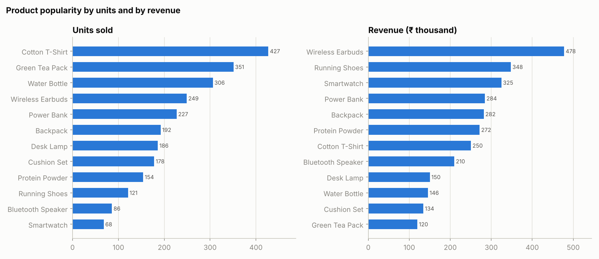
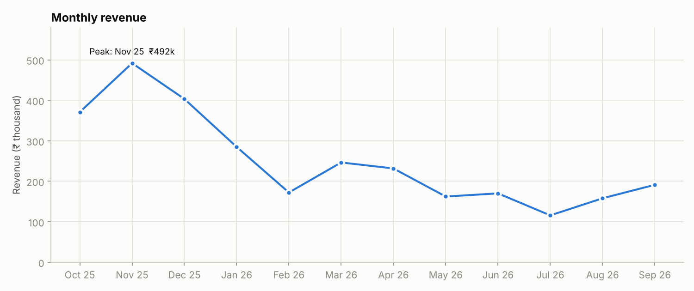
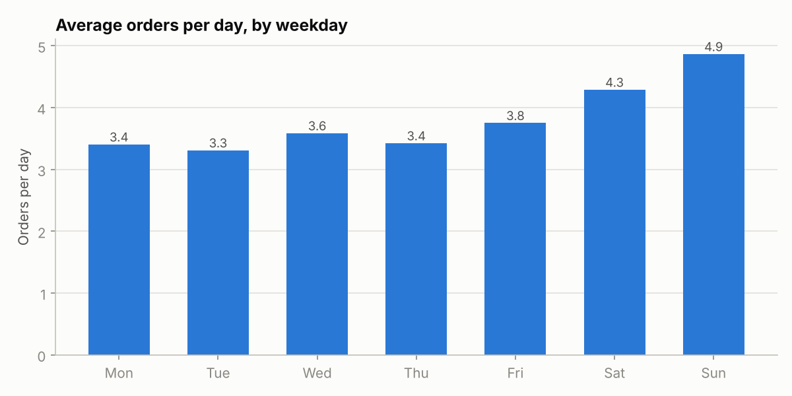
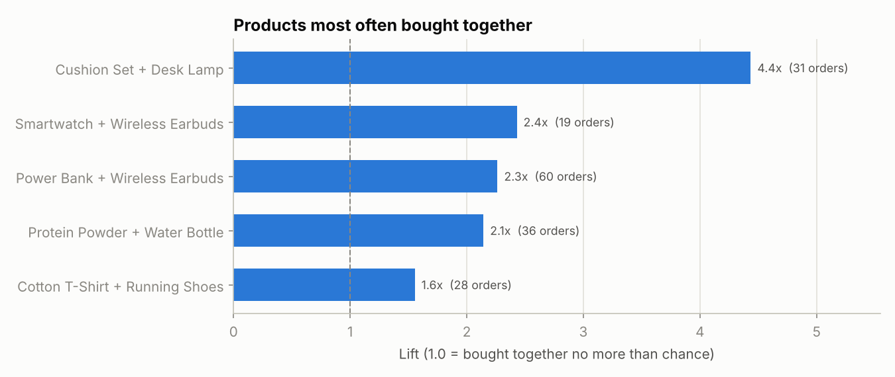
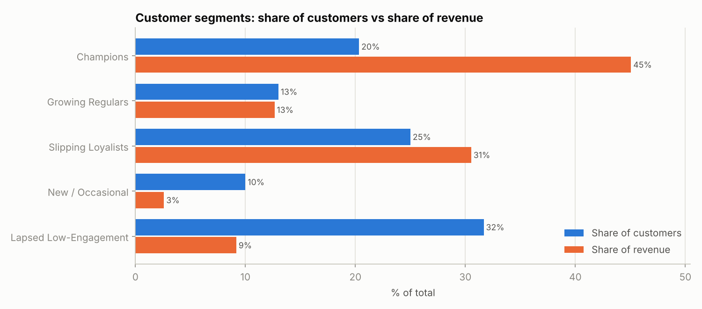

# Customer Behavior Analysis – Report of Insights

**Data:** synthetic purchase records, 2025-10-01 to 2026-09-30 (1,720 cleaned line items, 1,388 orders, 300 customers). Total revenue ₹29.99 lakh; average order value ₹2,160; 77% of customers ordered more than once.

## Summary
Electronics and a small group of loyal customers carry the business, sales spike in Oct–Dec and on weekends, and a quarter of customers are repeat buyers who have gone quiet. The recommendations below target those four points.

## Key findings and recommended actions

### 1. Electronics earns the most; unit volume and revenue tell different stories
- **Wireless Earbuds** is the top earner (₹4.78 lakh, 15.9% of revenue); Electronics is 43% of revenue overall.
- **Cotton T-Shirt** and **Green Tea Pack** sell the most units (427 and 351) but rank 7th and last by revenue. **Smartwatch** sells the fewest units (68) yet ranks 3rd by revenue.
- **Action:** keep Electronics well stocked and prominent; use the high-volume low-price items as add-ons and traffic builders, and promote high-ticket items to existing customers.

### 2. Sales are seasonal and lean towards weekends
- Oct–Dec brings 42% of the year's revenue. The peak month (Nov 25) earned ₹4.92 lakh, against an average of ₹1.93 lakh for Jan–Sep.
- Weekend days see **1.31x** the orders of weekdays.
- **Action:** plan stock and campaigns from September; schedule promotions and email sends to land from Friday evening.

### 3. Few orders contain more than one product, and clear product pairs exist
- Only 23% of orders have 2+ products (1.24 items per order on average).
- **Power Bank + Wireless Earbuds** is the most frequent pair (60 orders, bought together 2.26x more often than chance); **Cushion Set + Desk Lamp** has the strongest link (lift 4.44, 31 orders).
- **Action:** offer bundles and "frequently bought together" suggestions on these pairs to raise items per order.

### 4. A small group of customers drives revenue
- **Champions** (6+ orders, active in the last 90 days) are 20% of customers but 45% of revenue. The top 20% of customers account for 51% of revenue.
- **Action:** protect this group with early access, loyalty rewards and priority service.

### 5. Many repeat buyers have gone quiet
- **Slipping Loyalists** (3+ orders, nothing in 90 days) are 25% of customers and 31% of revenue (₹9.15 lakh of past spend, ₹12,206 per customer).
- **Lapsed Low-Engagement** customers are 32% of customers but only 9% of revenue.
- **Action:** run a win-back offer for Slipping Loyalists first (best return on effort); use only low-cost reactivation messages for the lapsed group.

## Method and limits
- Cleaning (Pandas): 1,762 raw rows reduced to 1,720; every step is logged in the notebook (duplicates, mixed date formats, text prices, inconsistent text, blanks, negative quantities).
- Segments use simple RFM rules: the 90-day recency cut-off and the 3 and 6 order thresholds are my choices, so a different cut-off would move customers between segments.
- Product pairs use lift on order baskets; lift shows association, not that one product causes the purchase of the other.
- The data is synthetic, so the figures show the method and the kind of insight, not the results of a real business.
- Actions are recommendations to test (for example with a small bundle or win-back pilot), not guaranteed outcomes.
